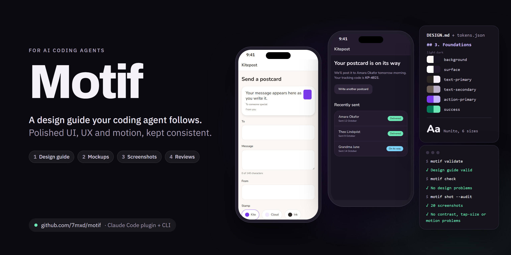

<p align="center"></p>

# Motif

Design guide tools for AI coding agents: build web and mobile apps with polished UI, UX and motion — and keep them consistent as your app and team grow.

> **Preview (v0.4.2).** Motif works in Claude Code, Codex, Cursor, GitHub Copilot, Gemini CLI and OpenCode, for React web apps and plain web sites. Flutter apps arrive in v0.5.0 ([what each stack gets](docs/parity.md)). More stacks and the first full release come next.

## Install

**Claude Code**

```
/plugin marketplace add 7mxd/motif
/plugin install motif@motif
```

**Codex**

```
codex plugin marketplace add 7mxd/motif
codex plugin add motif@motif
```

**GitHub Copilot CLI**

```
copilot plugin marketplace add 7mxd/motif
copilot plugin install motif@motif
```

In VS Code, run "Chat: Install Plugin From Source" and enter `7mxd/motif`.

**Cursor:** add the plugin marketplace `7mxd/motif` in Cursor's plugin settings, or in the CLI run `cursor-agent plugin marketplace add https://github.com/7mxd/motif`.

**Gemini CLI**

```
gemini extensions install https://github.com/7mxd/motif --ref plugins --auto-update
```

**OpenCode, or any agent that reads `~/.agents/skills`**

- macOS and Linux: `curl -fsSL https://raw.githubusercontent.com/7mxd/motif/main/install.sh | sh`
- Windows PowerShell: `irm https://raw.githubusercontent.com/7mxd/motif/main/install.ps1 | iex`

Then ask for design work ("make this screen look better"), or start Motif: `/motif:design` in Claude Code, `$motif` in Codex, `/motif` everywhere else.

You need git, and Claude Code 2.1.224 or later if you use Claude Code. The first time Motif runs, it downloads its tool (about 100 MB) from the [release](https://github.com/7mxd/motif/releases/tag/v0.4.2) and checks it against the release's checksums. See the [release notes](docs/releases/v0.4.2.md), or build and try Motif from source: [Claude Code](plugin/claude-code/README.md), [other agents](plugin/agents/README.md).

## The `motif` tool

| Command | What it does |
|---|---|
| `motif doctor` | Explains what works on this computer and what's optional |
| `motif connect` | Connects optional design sources (Motion, Refero, 21st.dev, 60fps.design) to the coding agents you choose, for all your projects; keys are typed only in your own terminal |
| `motif validate` | Checks your design guide (`DESIGN.md` + `design/tokens.json`); `--tokens <file>` checks one theme values file, such as a design direction's |
| `motif tokens` | Turns your design guide into theme code (React web: CSS variables, a Tailwind v4 theme, Motion timings; plain web sites: `motif.css` in the site folder; Flutter, from v0.5.0: `lib/design/motif_theme.dart`, with a `ThemeExtension`, light and dark `ThemeData` and every variant, or one file for several apps in the `themeDir` that `design/motif.json` names); `--stack preview` writes the CSS mockups use |
| `motif check` | Finds colours, sizes, fonts and animations in your code (CSS, HTML, JavaScript, TypeScript and Dart) that bypass your design guide |
| `motif extract` | Drafts a design guide from an existing app's code; in a Flutter app (from v0.5.0), from its `ThemeData`, `ColorScheme` and palette classes, with parallel palettes (light and dark, or one per brand) as variants |
| `motif preview` | Shows mockups in your browser with live reload and saves them as PNGs in light and dark; `--variant <id>` (or `all`) shows a design variant; `--compare` puts several side by side, `--gallery` shows the 8 starting styles; mockups show your theme's real fonts |
| `motif shot` | Screenshots your real app's pages at three phone sizes (360, 390 and 430 px wide, as tall as a phone browser shows), a tablet and a desktop, in light and dark (starting its dev server if needed, or serving a plain web site's folder itself); `--state <script>` also captures states behind a form or a click; `--audit` checks contrast, tap-target sizes, reduced motion and controls with no name (under `accessibility`) as rendered; `--against` puts them side by side with the mockup while you build, or with an earlier run (`--save before`) after a rebuild, and says whether a page changed, grew or only moved; `--sizes 390,1440` takes only some sizes for a quick run; `--variant <id>` (or `all`) screenshots a design variant; `--rtl` also screenshots every page right to left (Arabic unless you name another language) |
| `motif browser` | Shows which browser previews use; `motif browser install` downloads a private one if you have none |

Add `--json` for machine-readable output and `--cwd <folder>` to run elsewhere. In a project with several apps, `--app <path>` picks one.

Full support in v0.4.2: React web apps and plain web sites (HTML, CSS and JavaScript without a framework: a folder with an `index.html` in it, `public/`, `src/`, `site/` or `www/`). Flutter apps, also inside a monorepo (apps under `mobile/`, say, with a shared package), arrive in v0.5.0. `motif check` and `motif extract` read CSS where it is, including `<style>` blocks and `style=""` attributes. Other stacks are detected, and Motif helps on them with general guidance; [the parity checklist](docs/parity.md) says what a stack gets once it's supported.

From v0.5.0, on Flutter, `motif shot` needs the Flutter SDK (3.27 or later; `motif doctor` checks it) and draws the screens with `flutter test`: no device, simulator or Mac. It takes the app's routes (go_router or named routes) at three phone sizes and a tablet, and `--screen <Widget>` adds a widget no route opens. A state is a Dart script (`--state design/states/<name>.dart`). Screens behind sign-in or live data need `design/states/setup.dart`, which runs before the app starts (sign someone in, store settings, pick the variant), and `design/states/http.json`, which answers the app's requests from files under `design/`; nothing leaves your computer. Motif's harness lives in the app's `.motif/` folder, which git ignores.

Motif's tool includes axe-core 4.14.0 (MPL-2.0), unchanged, for the rendered checks; its source is at https://github.com/dequelabs/axe-core/tree/v4.14.0, and THIRD-PARTY-NOTICES.txt lists everything Motif includes with its licence.

Previews and screenshots run on your computer only: the preview server listens on `127.0.0.1`, serves nothing outside your project, and nothing is uploaded. Screenshots of your app go to `design/shots/`, which Motif keeps out of git. Motif uses the Chrome or Edge you already have; it downloads a browser only when you run `motif browser install`. The 8 starting styles' fonts come with Motif; any other font your theme names is loaded from Google Fonts by your browser while previewing.

Design: `docs/specs/2026-10-12-motif-core-design.md` · Plans: `docs/plans/`
