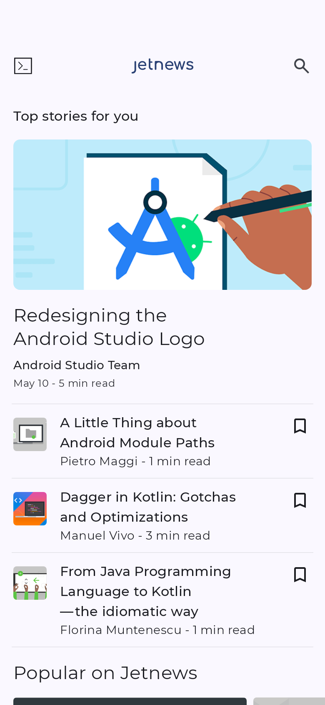
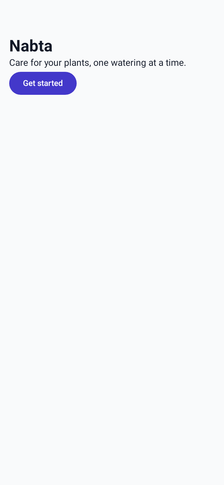

# Hands-on test: Motif on Google's JetNews (Jetpack Compose)

- **Date:** 2026-10-20
- **Plan:** [2F Jetpack Compose](../plans/2026-10-20-motif-2f-compose.md), Task 15, Step 5 (spec §11 of [Part 2](../specs/2026-10-19-motif-part2-all-stacks-design.md))
- **Motif:** branch `plan/2f-compose`, run from source (`bun cli/src/main.ts …`) on Windows 11, with Android Studio's JDK 21.0.5 (not on the PATH, no `JAVA_HOME`), the Android SDK in the usual folder, and no Gradle installed
- **JetNews:** `git clone --depth 1 https://github.com/android/compose-samples` at `0bc770fd` (2026-10-19), in a scratch folder. It is newer than Motif's fixtures: Gradle 9.5.0, the Android Gradle Plugin 9.3.1 (with its built-in Kotlin), Kotlin 2.4.20 and Compose BOM 2026.09.00. Its theme is Material 3's generated `Color.kt` (54 `md_theme_light_*` and `md_theme_dark_*` constants), `Theme.kt` (`LightColors`, `DarkColors`, and dynamic colour on Android 12 and later) and `Type.kt` (Montserrat from `res/font`).

This is the record of the test until the pull request exists. The eval cases (Step 6) are run by the controller after it.

## What was changed in the scratch copy

Only these, and only in the copy: `DESIGN.md` (ten short sections), `design/tokens.json` (the draft, renamed, unchanged), `design/states/loaded.kt` (step 5), and what Motif wrote itself (`design/motif.json`, `design/tokens.draft.json`, `design/extract-report.json`, `app/src/main/java/com/example/jetnews/ui/motif/MotifTheme.kt`, `design/shots/`). No file of JetNews's own was edited, and the app still uses its own `JetnewsTheme`: the test is Motif's theme *beside* the app's.

## Results

| Step | Result |
|---|---|
| 1. `doctor` | Passed |
| 2. `extract` drafts `Color.kt` and `Theme.kt`; a minimal guide validates | Passed: the light and dark schemes became light and dark values, with no variants (right: JetNews has one palette). It validated as drafted |
| 3. `tokens` beside the app's theme | Passed: the generated Kotlin compiles with JetNews's own Gradle 9.5 and AGP 9.3.1 |
| 4. `check` | Passed: 73 problems, 54 of them in the app's own palette file, which Motif names as such |
| 5. `shot --audit --variant all --rtl` | Passed after two fixes in Motif (problems 1 and 2). `--variant all` was refused on a guide without variants (problem 3); without it, 192 screenshots of 12 screens in 55 s |
| New app from an empty folder, no Gradle installed (the d-nabta risk) | Passed with the guide's new steps: wrapper, `compileDebugKotlin` and `motif shot` |

### 1. doctor

```
Motif doctor
  ✓ Motif tool — Version 0.4.2 (win32-x64).
  ✓ App (app) — Full support for Jetpack Compose.
  ✓ Screenshots and previews — Using Chrome.
  ✓ JDK — JDK 21.0.5.
  ✓ Android SDK — Android SDK at C:\Users\PC\AppData\Local\Android\Sdk (platforms 33, 34, 35, 36).
  ○ Design guide — None yet — /design will create one.
  ✓ Design sources — Connected: 21st.dev (Claude Code).
```

The module (`app`) is listed, not the project's folder. The JDK is Android Studio's own, found with nothing on the PATH. `doctor` doesn't read the plugin's version (the guide says so); here it is 9.3.1, well above the 8.6 floor.

### 2. extract

```
✓ Draft theme values written to design/tokens.draft.json (from 55 files).
  Colours: 8 found, grouped into 7
  Spacing: 15 values, 7 off a 4px scale
  Corners: 2 sizes · Text sizes: 11 · Fonts: monospace, Montserrat · Animation timings: 0
• Dark-mode colours came from your Kotlin theme code for text-primary, text-secondary, background, surface, border, action-primary, danger; the others were copied from light mode. …
• Your Kotlin theme code sets 65 colours (colour constants and scheme arguments); design/extract-report.json shows the role each matches.
• No colour was found for success, warning, info, so Motif used defaults.
• Type roles came from your TextTheme (app/src/main/java/com/example/jetnews/ui/theme/Type.kt:47): display 57 px, title 32 px, heading 22 px, body 16 px, label 14 px, caption 12 px.
• The system's monospace fonts became the optional mono role (font.mono), for code text.
```

- **Colours: right.** `action-primary` is JetNews's red `#BF0031` (dark `#FFB3B4`), `text-primary` `#201A1A`, `text-secondary` `#524343`, `border` `#857373`, `danger` `#BA1A1A`, `background` and `surface` `#FFFBFF`, each with its dark value from `DarkColors`, followed through the `md_theme_*` constants.
- **Type: right.** The six roles are Material's `displayLarge`, `headlineLarge`, `titleLarge`, `bodyLarge`, `labelLarge` and `bodySmall` sizes, in Montserrat, and `PostContent.kt`'s `FontFamily.Monospace` became `font.mono`.
- **Validation:** I renamed the draft to `design/tokens.json` and added a ten-section `DESIGN.md`. `motif validate`: "valid — 84 theme values and 26 readability checks (light + dark) passed." Nothing needed changing.
- **What a person would look at:** `action-secondary` is drafted as `surface` rather than JetNews's `secondary` (`#775656`), and Montserrat's bundled files aren't in the guide (problem 5).

### 3. tokens

```
✓ Theme code is ready:
  created    app/src/main/java/com/example/jetnews/ui/motif/MotifTheme.kt
  created    design/motif.json
Theme fonts: Montserrat 400 · 500 · 600 · 700. Your app needs to load them (your stack's Motif guide shows how).
• app uses Montserrat from Google Fonts, which needs Compose's downloadable fonts. Add this line to app/build.gradle.kts, under dependencies:
implementation(libs.androidx.compose.ui.googlefonts)
Then run motif tokens again. Until then, the theme uses the system font for Montserrat.
• Next: wrap your setContent in MotifTheme { … } (import com.example.jetnews.ui.motif.MotifTheme) in place of the template's own theme.
```

- `MotifTheme.kt` (427 lines) sits in `ui/motif/` beside JetNews's `ui/theme/`, which wasn't touched. It compiled as part of every screenshot run's `compileDebugKotlin`, on Kotlin 2.4.20 and AGP 9.3.1, with no warnings from it (the build's one warning is JetNews's own `currentWindowAdaptiveInfo` deprecation).
- The dependency note is right and short: JetNews's catalogue already names `androidx-compose-ui-googlefonts`, so only the dependency line is printed, under the catalogue's own alias.

### 4. check

`motif check` found 73 problems in 10 files, in a fraction of a second:

- **54 typed colours, all in `ui/theme/Color.kt`,** which is JetNews's palette. Motif says so: "app/src/main/java/com/example/jetnews/ui/theme/Color.kt is your own theme's palette: once the app uses Motif's theme, remove it, or list its folder under "ignore" in design/motif.json." Each group names the nearest role (`MotifTheme.colors.actionPrimary` for `#BF0031`).
- **16 sizes off the scale:** 11 paddings (10, 14, 15, 2, 6, 28 and 72 dp, in `PostCards.kt`, `HomeScreens.kt`, `AppDrawer.kt`, `InterestsScreen.kt` and the Glance widget), each with the nearest `MotifSpace` step, and 5 font sizes in `Type.kt` that the draft's six roles don't keep (45, 36, 28, 24 and 11 sp; problem 6).
- **2 typed fonts:** `FontFamily.Monospace` for code blocks in `PostContent.kt`, with "Use MotifType.<role>" (the generated theme has `MotifType.mono`).
- **1 reduced-motion finding:** `ListDetailScene.kt:57` animates without `MotifMotion`. Right: JetNews doesn't check Remove animations.

### 5. shot

**The first run failed after a successful build** (problem 1): "Couldn't take screenshots: Gradle stopped before drawing any screen", with Gradle's log ending in `testDebugUnitTest NO-SOURCE` and `BUILD SUCCESSFUL in 3m 12s`. AGP 9's built-in Kotlin compiles only a source set's `kotlin` folders, and Motif's init script added its test only under `java`. Fixed (below), and the run then drew.

**`motif shot --audit --variant all --rtl`** was refused: "This design guide has no variants." It now says what to do (problem 3). **`motif shot --audit --rtl`** took 192 screenshots of 12 screens in 55 s (three phone sizes and a tablet, light and dark, left to right and Arabic): `/` and 11 of the 21 previews, with notes that two previews take a `@PreviewParameter` and were left out, that nine more were past the cap (named, with `--routes` and `--screen`), and that JetNews has no `values-ar`, so its Arabic shots keep English strings, laid out right to left.

**What the pictures show** (I looked at a dozen): the real app in Montserrat, light and dark, mirrored right to left (the drawer, the top bar's icons, the snackbar), the tablet's two-column Interests screen, and Arabic-Indic digits in "min read ٥" under the Arabic locale. The colours are Android's dynamic colour, not JetNews's red: JetNews asks for `dynamicLightColorScheme` on Android 12 and later, and Robolectric's Android 15 gives its default wallpaper's blue. That is what the app does on a phone with that wallpaper.

**The start screen was a spinner** (problem 4): JetNews's fake repository waits 800 ms on `Dispatchers.IO`, and Motif waits only until Compose is idle. A state that sleeps (`design/states/loaded.kt`, below) drew it loaded. In one of the four, the dark Arabic one, JetNews's own "every fifth request fails" rule showed its "Can't update latest news" snackbar: the app's behaviour, not Motif's.

```kotlin
// design/states/loaded.kt (in the scratch copy)
package dev.motif.states.loaded

import androidx.compose.ui.test.junit4.ComposeContentTestRule

fun motifState(rule: ComposeContentTestRule) {
    Thread.sleep(2_000) // Motif lets the screen settle again afterwards, which runs what the repository posted.
}
```

**Audit:** first 3 major findings, then 1 after problem 2's fix:

- Right: JetNews's `BookmarkButton` (an `IconToggleButton` whose icon has `contentDescription = null` and only a click label) has no name: "The element has no name a screen reader can say." TalkBack would say "Not checked, checkbox".
- Wrong, and fixed: the two "Popular on Jetnews" cards at the bottom of the home screen, which show only their pictures there, were "buttons with no name". ATF reads only what's on screen; their titles are below its edge (problem 2).
- audit.json's scope said `screens: /` for a run of `/` and 11 previews (problem 7, fixed).




The JetNews screenshots show Google's sample app and its sample content (Apache License 2.0).

## A new app with no Gradle installed (the d-nabta risk)

Task 13's review asked whether an unattended session can start a Compose app from an empty folder: the guide said to make the wrapper with an installed Gradle or with Android Studio, and this computer, like an eval's, has neither Gradle nor `java` on the PATH. The guide now makes the wrapper without either ([the Compose guide](../../skill/adapters/compose/README.md#starting-a-new-project)), and I followed it in PowerShell in an empty folder:

1. With no `JAVA_HOME`, Gradle stops: "ERROR: JAVA_HOME is not set and no 'java' command could be found in your PATH." The guide's first step sets `JAVA_HOME` to Android Studio's `jbr` for the commands.
2. No Gradle on the PATH, so I took the guide's last choice: `curl -fsSLo gradle-8.14.3-bin.zip https://services.gradle.org/distributions/gradle-8.14.3-bin.zip` (137 MB) into a new temporary folder, checked against the `.sha256` beside it (`bd711022…f3531`, a match), and `Expand-Archive`.
3. An empty `settings.gradle.kts`, then `…\gradle-8.14.3\bin\gradle.bat wrapper --gradle-version 8.14.3`: `BUILD SUCCESSFUL in 8s`, writing `gradlew`, `gradlew.bat` and `gradle/wrapper/gradle-wrapper.jar`. The middle choice, a Gradle another build had already downloaded (`~/.gradle/wrapper/dists/gradle-8.7-bin/…/bin/gradle.bat`), made the same wrapper in 4 s with no download.
4. The template's files as the guide lists them (the catalogue copied from the guide), `local.properties` with `sdk.dir=C:/Users/PC/AppData/Local/Android/Sdk` in forward slashes, a design guide, `motif tokens`, and `MainActivity` wrapped in `MotifTheme`.
5. `.\gradlew :app:compileDebugKotlin`: `BUILD SUCCESSFUL in 28s`, with no `ANDROID_HOME` (the SDK came from `local.properties`).
6. `motif shot --sizes 390`: 4 screenshots of `/` and the welcome preview, in 17 s, in light and dark.



## Problems found in Motif

| # | Severity | Problem | Status |
|---|---|---|---|
| 1 | Critical | **Screenshots drew nothing on AGP 9.** The init script added the harness's test folder only under the test source set's `java` folders; AGP 9's built-in Kotlin compiles only `kotlin` folders, so the test task said NO-SOURCE and Motif said "Gradle stopped before drawing any screen" after a successful build. Every app on AGP 9 (the template's next version) would have failed. | Fixed: "fix(shot): Compose screenshots work with AGP 9's built-in Kotlin" (the folder goes under both; AGP 8 with the Kotlin plugin still draws) |
| 2 | Important | **The name audit called a card unnamed when its text was past the screen's edge.** ATF reads what's on the screen; the merged semantics tree names the card. | Fixed: "fix(shot): a Compose control whose text is past the screen's edge isn't called unnamed", with an end-to-end test |
| 3 | Minor | **`--variant` on a guide without variants was refused without saying what to do.** On every stack. | Fixed: "fix(shot, preview): --variant on a guide without variants says what to do next" |
| 4 | Important | **A screen that loads off the main thread is drawn loading.** Motif waits for Compose to be idle; JetNews's repository works on `Dispatchers.IO`, as most apps' do. A state with `Thread.sleep` works around it; `rule.waitUntil` timed out under Robolectric, even when it idled the main looper. | Guide fixed: "docs(skill): a Compose screen that loads off the main thread needs a state that waits". The harness itself still draws the first idle frame: a later change could wait a moment longer and settle again, or register an idling resource for the app's dispatchers |
| 5 | Moderate | **A main font bundled in `res/font` is drafted as a Google font.** JetNews ships `montserrat_regular.ttf` and `montserrat_medium.ttf`; the draft names Montserrat without its files, so `tokens` asks for `ui-text-google-fonts` and Google Play services. Flutter's extract does the same: only a bundled Arabic companion's files go in the draft. | Open: extract could put the app's bundled files for its main family in the guide's fonts |
| 6 | Minor | **`check` reports the app's own `Type.kt` sizes as off the scale,** while `Color.kt` gets a line saying it's the app's palette. `Type.kt` is the app's own type setup too, and goes once the app uses `MotifType`. | Open |
| 7 | Minor | **audit.json's scope left out the previews** (and Flutter's `--screen` widgets). | Fixed: "fix(shot): audit.json's scope names the previews and widgets the run drew" |
| 8 | Minor | **`gradlew` needs `JAVA_HOME` where `motif shot` doesn't.** Motif finds Android Studio's JDK itself; the developer's own `./gradlew` (the guide's type check) stops without it. | Guide fixed in the wrapper commit (the build section says what to set). `doctor` could name the JDK's folder, not only its version |
| 9 | Minor | **A failed run that built fine says only "Gradle stopped before drawing any screen".** When the test task says NO-SOURCE, Motif could say its test wasn't compiled. | Open |

## Not covered

- The eval cases (Step 6): run by the controller after this task; the result goes in [docs/parity.md](../parity.md) (the Compose Evals row).
- The generated theme on a phone or an emulator: JetNews wasn't switched to `MotifTheme`, and no device was used.
