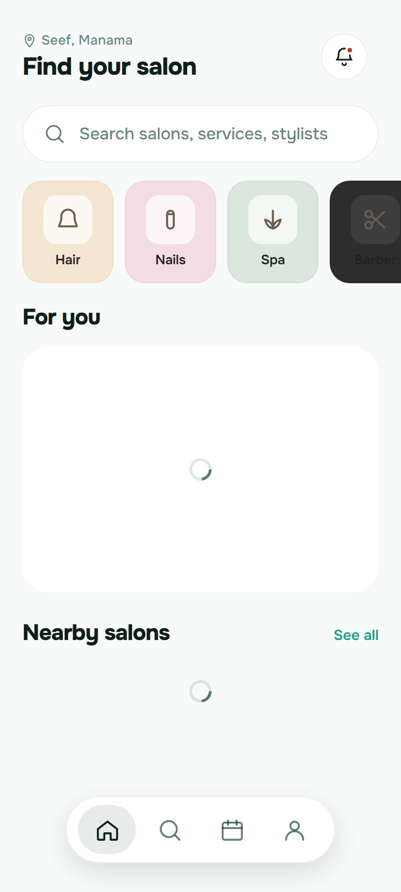
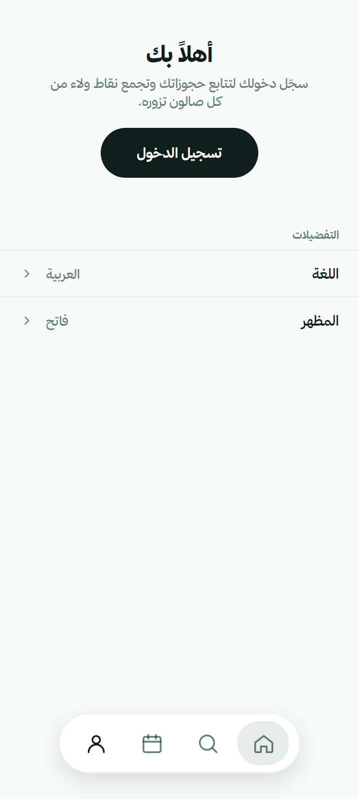
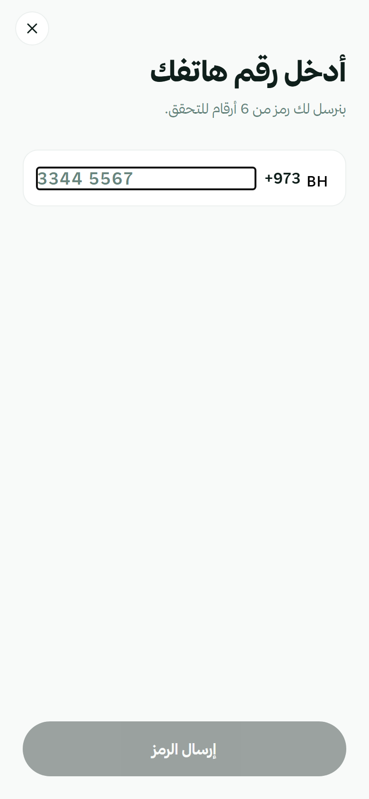

# Hands-on test: Motif on HiSalon's Expo app

- **Date:** 2026-10-20
- **Plan:** [2G React Native with Expo](../plans/2026-10-20-motif-2g-expo.md), Task 13, Step 5
- **Motif:** branch `plan/2g-expo`, run from source (`bun cli/src/main.ts …`) on Windows 11, with Chrome
- **HiSalon:** a copy of `mobile/react-native` (Expo SDK 54, React Native 0.81.5, TypeScript) from the developer's checkout at `9fca95983`, in a scratch folder outside the repository, without `node_modules`, `.expo` or build folders. The real repository was never touched, and nothing was run inside it.

The app is HiSalon's earlier customer app, from before the Flutter port: Discover, Search, My Bookings and Profile tabs, salon pages and a booking flow. It has no Expo Router and no React Navigation linking config: its screens are a tab state and a Zustand stack, so `motif shot` finds one route, `/`, and the other screens are reached with state scripts. It reads its data from HiSalon's API (`EXPO_PUBLIC_API_BASE_URL`, `http://localhost:4000` by default). No API was running and no env file was copied, so nothing left the computer.

## What was changed in the scratch copy

Only these, and only in the copy:

- `git init` and a first commit, to see what Motif adds.
- `npm ci` (from the app's `package-lock.json`).
- `npx expo install react-native-reanimated react-native-worklets`, the line `motif tokens` printed (step 3).
- Added `DESIGN.md` (ten short sections), `design/tokens.json` (the draft, renamed, with two values changed so it validates, step 2) and three state scripts in `design/states/`.
- `motif tokens` wrote `src/design/motif-theme.tsx` and `design/motif.json`.
- No file of HiSalon's own was edited.

## Results

| Step | Result |
|---|---|
| 1. `doctor` | Passed |
| 2. `extract` drafts the app's light and dark palette; a minimal guide validates | Failed at first: the palette wasn't read, so dark mode was copied from light. Fixed (problem 1); passed after the fix, with two values changed so the guide validates. Some roles and the fonts need work (problems 4–6) |
| 3. `tokens` | Passed. The theme type-checks once Reanimated is installed, as the note said |
| 4. `check` | Passed: 376 problems in 31 files, and they make sense |
| 5. `shot --audit --variant all --rtl` | `--variant all` was refused: the guide has no variants (problem 3). Without it, every screen reached rendered, in English and Arabic, at every size. The audit found real problems, missed the unnamed tab bar (problem 2, fixed) and has some noise (problems 7, 8) |

### 1. doctor

```
Motif doctor
  ✓ Motif tool — Version 0.4.2 (win32-x64).
  ✓ App (this folder) — Full support for React Native (Expo).
  ✓ Screenshots and previews — Using Chrome.
  ✓ Node.js — Found. Your app needs it to run (Motif itself doesn't).
  ✓ Expo web target — Expo SDK 54, with the web target's packages.
  ○ Design guide — None yet — /design will create one.
  ✓ Design sources — Connected: 21st.dev (Claude Code).
```

The app already lists `react-dom`, `react-native-web` and `@expo/metro-runtime`, so nothing was needed for screenshots.

### 2. extract

The app's palette is `src/theme/colors.ts`: two typed top-level objects, `export const light: Palette = { … }` and `export const dark: Palette = { … }` (17 colours each, some `rgba()`), then `palettes = { light, dark }`. The first run didn't read them:

```
✓ Draft theme values written to design/tokens.draft.json (from 55 files).
  Colours: 97 found, grouped into 50
• Dark-mode colours were copied from light mode. Review them before turning on dark mode.
```

Motif only looked for `light` and `dark` objects *inside* another object (the starter's `Colors = { light, dark }`). It now also pairs top-level objects named for their half (`light`/`dark`, `lightColors`, `menDark`), with the name's other words as the variant (problem 1). After the fix:

```
✓ Draft theme values written to design/tokens.draft.json (from 55 files).
  Colours: 83 found, grouped into 47
  Spacing: 20 values, 11 off a 4px scale
  Corners: 17 sizes · Text sizes: 16 · Fonts: Onest · Animation timings: 3
• Dark-mode colours came from your theme code for text-primary, background, surface, success, danger, text-secondary; the others were copied from light mode. Review them before turning on dark mode.
• Your theme code sets 17 colours (colour roles in light and dark objects); design/extract-report.json shows the role each matches.
• text-secondary comes from --text-muted, which is see-through (rgba(15, 60, 50, 0.65)): drafted as #617E78, how it shows over the background (in dark mode and each variant, over theirs). Check it.
• No colour was found for border, so Motif used defaults.
```

`background`, `surface`, `text-primary`, `text-secondary`, `success` and `danger` follow the palette in light and dark. With the draft renamed to `design/tokens.json` and a short `DESIGN.md`, validate found four problems, all real:

- `text-secondary` (the app's `textMuted`, 65% ink) is 4.20:1 on the background and 4.40:1 on cards. The app's muted text really is below 4.5:1; the audit found it on screen too. Changed to a solid `#557069`.
- `focus` (and `action-primary`) was `#D4A574`, a tan from the category cards' art, 2.12:1 (problem 4). Changed to the app's `accent`, `#1F9F87`.

Validate then said: "valid — 77 theme values and 26 readability checks (light + dark) passed."

### 3. tokens

```
✓ Theme code is ready:
  created    src/design/motif-theme.tsx
  created    design/motif.json
Theme fonts: Onest 400 · 500 · 600 · 700. Your app needs to load them (your stack's Motif guide shows how).
• Your app needs packages it doesn't list yet (useFonts comes from expo-font, and the theme file imports the rest). Install them, then run motif tokens again:
npx expo install react-native-reanimated react-native-worklets
• Next: wrap your root layout in <MotifProvider> (import from @/design/motif-theme), load motifFonts with useFonts from expo-font before rendering, and read colours with useMotifTheme().
```

- The theme went in `src/design/` (the app has `src/` and an `@/*` alias to it), 188 lines, next to the app's own `src/theme/`, which wasn't touched; neither was `package.json`, `app.json` or `babel.config.js`.
- Onest came from the `@expo-google-fonts/onest` package the app already lists.
- Before Reanimated was installed, `npx tsc --noEmit` failed only on the theme's `react-native-reanimated` import. After the printed `npx expo install` line (Reanimated 4.1.1 with worklets 0.5.1), `tokens` said "up to date" and `tsc` found no errors.
- The note says "your root layout"; this app has no layout file, only `App.tsx` (problem 9).

### 4. check

`motif check` found 376 problems in 31 files (55 read) in under a fifth of a second: 216 off-scale sizes, 156 typed colours, 3 typed easings and 1 reduced-motion finding.

- **The top groups are the app's own steps.** Text sizes of 12 (22×), 18, 11, 26 and 22 px; spacing of 10 (15×), 2, 14 and 6 px; corners of 20, 14 and 16 px. HiSalon spaces on a 2 px step and uses more text sizes than the draft's six roles, so most of these would clear with a guide that has them. The draft's caption role is 10 px though 12 and 11 px are commoner (problem 6).
- **The colours are real.** `#FFFFFF` ×13 on the discover cards, `#000` shadows, `#F5B800` stars, and the salons' fallback gradients in `src/data/salons.ts` and `src/lib/tenant-adapter.ts`. Each names the role to use (`colors.surface`, `colors.warning`).
- **The palette file is recognised:** "src/theme/colors.ts is your own theme's palette: once the app uses Motif's theme, remove it, or list its folder under "ignore" in design/motif.json."
- **Motion:** the tab bar's `Animated` indicator uses `Easing.out(Easing.exp)` three times and never reads the reduce-motion setting; both are reported at their lines. Its durations (90, 120 and 220 ms) became the draft's scale, so they pass.

### 5. shot

`motif shot --audit --variant all --rtl` stopped at once with "This design guide has no variants." (exit 2), with nothing to do next (problem 3). The runs that worked:

- **`motif shot --audit --rtl --state design/states/profile.js --state design/states/search.js`:** 48 screenshots of `/` and its two states (three phone sizes and a tablet, light and dark, English and Arabic) in 1 minute 57 seconds, the Expo web bundle included. The run said, as it should: "React Native screenshots are of Expo's web target in Chrome: close to the app, but native-only components and platform fonts can differ." and "/ doesn't switch to right to left by itself for ar; Motif set dir="rtl" to show it."
- **`motif shot --audit --rtl --sizes 390 --state design/states/sign-in.js`:** 8 screenshots in 29 seconds, the sign-in (phone number) screen among them.

The state scripts click the tab bar's tabs (`[role="tab"]`, from `accessibilityRole="tab"`) and, for sign-in, the Profile tab's "Sign in" button.

**What the pictures show** (I looked at nine): the real app, signed out. Discover shows its header, search field, category cards and tab bar in Onest; the salon lists show spinners, as nothing answers the API. Profile shows "Welcome" and the preferences; sign-in shows the phone field with +973. In Arabic every string is Arabic, in Thmanyah Sans, and the layout mirrors, the tab bar included. Two things differ from a phone, both from the web target:

- The app never calls `I18nManager.forceRTL` and keeps its tab bar left to right on phones, mirroring only some rows itself. On the web Motif's `dir="rtl"` mirrors everything, and the tab bar's sliding indicator, positioned with `translateX`, then sits on the wrong tab.
- The dark screenshots are light: the app's `ThemeProvider` starts in light whatever the phone says. That's right for this app, but the run didn't say so (problem 7).

**Audit** (first run): 1 critical, 8 major, 17 minor. With the fix for problem 2, the sign-in run found 4 more: the tab bar's four icon-only tabs have no name.

- Real: "Barber" on its dark category card is 1.15:1 (critical); the muted text (4.16:1), the search placeholder (4.28:1) and "See all" in the mint accent (3.14:1); the notification bell and the search screen's back button have no name; the bell (42 px), "See all" (41×17), the back button (36–40 px), the filter chips (37 px tall), "Filters" and the text fields are under 44 px.
- Missed, then fixed: the unnamed tabs (problem 2).
- Likely noise: three reduced-motion findings that are probably the loading spinners (problem 8).
- Each finding's fix is in React Native's words: `accessibilityLabel`, `hitSlop`, `useReducedMotion()`.
- The contrast findings say "in light and dark mode" because the app draws light in both.

The app also shows a missing translation, `search.resultsCount`, on the search screen: HiSalon's, not Motif's.





These screenshots show HiSalon's app signed out, with no data: nothing personal is in them.

## Problems found in Motif

| # | Severity | Problem | Status |
|---|---|---|---|
| 1 | Important | **`extract` didn't read a palette written as two top-level objects** (`export const light: Palette = { … }`, `export const dark = { … }`), only `light` and `dark` inside another object, so the whole palette was missed and dark mode was copied from light. | Fixed: "fix(extract): an Expo app's top-level light and dark palette objects are paired by name". Objects with fewer than two colours, or with a style's colour keys (`backgroundColor`), aren't taken for palettes |
| 2 | Important | **The name audit skipped tabs.** On Expo's web target a `Pressable` with `accessibilityRole="tab"` is `role="tab"`, which neither axe's name rules nor Motif's own check covered, so an icon-only tab bar (HiSalon's four tabs) passed. Switches, checkboxes, radios, menu items and options had the same gap. | Fixed: "fix(audit): an Expo app's unnamed tabs, switches and checkboxes are reported". React Native apps only; web audits are unchanged |
| 3 | Minor | **`--variant all` on a guide without variants is refused with no next step** ("This design guide has no variants.", exit 2). Every refusal should say what to do; `all` could also just draw the default. The same message comes from `preview` and from every stack. | Open |
| 4 | Moderate | **Some drafted colour roles are off.** `action-primary` and `focus` became `#D4A574` from the category art, not the app's `accent` (`#1F9F87`): "accent" isn't a name for `action-primary` (and can't simply be one, since shadcn's `--accent` is a hover fill). `cardBorder` isn't taken for `border`, which gets the default `#D1D5DB` in dark mode too. | Open |
| 5 | Moderate | **No Arabic companion, and the bundled font isn't found.** The app loads Thmanyah Sans with `useFonts(fontAssets)`, an object defined elsewhere with `require("…ttf")` entries, and uses it for Arabic. `extract` reads only `useFonts({ … })` written inline and `@expo-google-fonts` imports, so it lists only Onest, and the draft has no companion. | Open |
| 6 | Minor | **The draft's type roles miss the commonest small sizes.** Caption is 10 px, while 12 px (22 uses) and 11 px (11) are common, so `check` suggests `type.label (13px)` for 12 px text. | Open |
| 7 | Moderate | **"Dark looks like light" needs byte-identical pictures.** HiSalon draws light in dark mode, but its loading spinners make each dark screenshot differ by a few pixels, so the note isn't given (the identical-variant note works the same way). | Open |
| 8 | Minor | **Loading spinners are reported as motion that ignores reduced motion** (three major findings), with advice (`useReducedMotion()`) that doesn't apply to `ActivityIndicator`. | Open, to confirm which elements they are |
| 9 | Minor | **The wiring note says "your root layout"** for an app without Expo Router, whose root is `App.tsx`. | Open |

Not Motif's to fix, but worth knowing: Expo's web target mirrors what the app keeps left to right on a phone when the app doesn't use `I18nManager`, and an app whose screens need an API or a signed-in user shows spinners and signed-out screens, since React Native has no `setup` or `http.json` like Flutter's (state scripts run after load).

## Not covered

- The eval cases (Step 6): run by the controller after this task; the result goes in [docs/parity.md](../parity.md) (the React Native Evals row).
- Running the generated theme in the app (wrapping it in `MotifProvider`) and on a phone.
