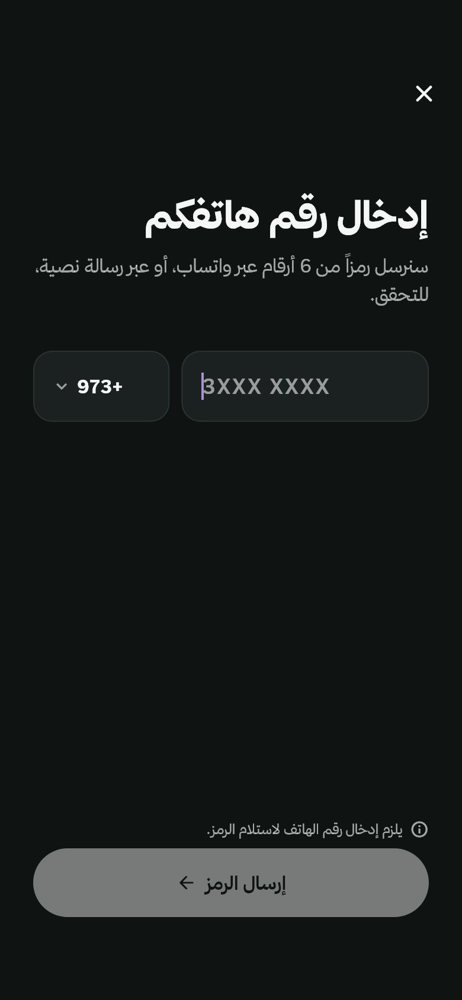
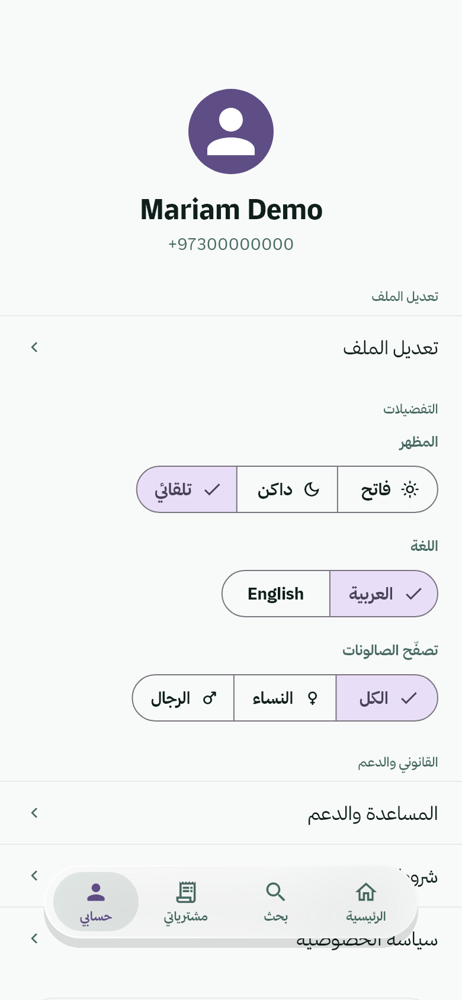
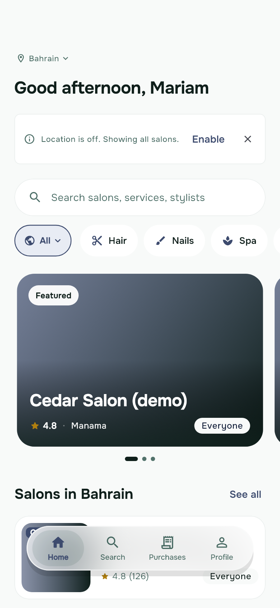

# Hands-on test: Motif on HiSalon's Flutter customer app

- **Date:** 2026-10-20
- **Plan:** [2E Flutter](../plans/2026-10-19-motif-2e-flutter.md), Task 15, Step 5 (spec §11 of [Part 2](../specs/2026-10-19-motif-part2-all-stacks-design.md))
- **Motif:** branch `plan/2e-flutter`, run from source (`bun cli/src/main.ts …`) on Windows 11, Flutter 3.44.8 (Dart 3.12.2)
- **HiSalon:** a local clone (`git clone --local`) of the developer's repository at `604a8ae96` (branch `sayed-dev`), in a scratch folder. The real repository was never touched, and the scratch copy was deleted afterwards.

This is the record of the test until the pull request exists. Item 6 of the step (running the generated theme on the developer's iPhone through the Mac mini) is the developer's, and isn't covered here.

## What was changed in the scratch copy

Only these, and only in the copy:

- `flutter pub get` in `mobile/packages/hisalon_core` and `mobile/customer`. Every dependency resolved, the private `hipay_flutter` git dependency included (it came over SSH with the developer's key), so nothing was commented out. pub get updated three entries in `mobile/customer/pubspec.lock`.
- Added `DESIGN.md`, `design/tokens.json` (the draft, renamed), `design/motif.json`, `design/states/setup.dart`, `design/states/http.json` and three fixture files under `design/fixtures/` (a made-up customer, three made-up salons, an empty app-version answer).
- One value in the drafted guide: `color.focus` in the default palette's light mode, from the mint accent `#7EEBC1` to the deep green `#0E5C4D` (see step 2).
- `motif tokens` wrote `mobile/packages/hisalon_core/lib/design/motif_theme.dart`.
- No file of HiSalon's own was edited.

## Results

| Step | Result |
|---|---|
| 1. `doctor` lists the apps | Passed |
| 2. `extract` drafts the three palettes as variants; a minimal guide validates | Passed after one value was changed so the guide validates. The draft's type roles and some colour roles need work (problems 4–6) |
| 3. `tokens` writes one theme into the shared package | Passed |
| 4. `check` reports sensibly | Passed, with two problems in Motif (1, 7) |
| 5. `shot --audit --variant all --rtl` reaches sign-in and signed-in screens in every variant, light and dark, and Arabic | Passed at every size (no `--sizes` needed). The audit's list is noisy (problems 2, 3, 8, 9) |

### 1. doctor

```
Motif doctor
  ✓ Motif tool — Version 0.4.2 (win32-x64).
  ✓ App (admin) — Full support for React (web).
  ✓ App (dashboard) — Full support for React (web).
  ✓ App (mobile/admin) — Full support for Flutter.
  ✓ App (mobile/customer) — Full support for Flutter.
  ○ App (mobile/react-native) — React Native (Expo) detected. Full support is coming soon; Motif will still help using general guidance.
  ✓ App (web) — Full support for Plain web (HTML and CSS); its pages are in site/.
  ✓ Screenshots and previews — Using Chrome.
  ✓ Node.js — Found. Your app needs it to run (Motif itself doesn't).
  ✓ Flutter SDK — Flutter 3.44.8 (Dart 3.12.2).
  ○ Design guide — None yet — /design will create one.
  ✓ Design sources — Connected: 21st.dev (Claude Code).
```

All three mobile apps are listed, and `mobile/packages/hisalon_core` isn't. The web apps around them were found too.

### 2. extract

`motif extract --app mobile/customer` read 218 Dart files (the app and `hisalon_core`) in under a second:

```
✓ Draft theme values written to design/tokens.draft.json (from 218 files).
  Colours: 46 found, grouped into 30
  Spacing: 31 values, 21 off a 4px scale
  Corners: 16 sizes · Text sizes: 10 · Fonts: Onest, Dancing Script, Great Vibes, ThmanyahSans · Animation timings: 14
• Your palettes give 3 design variants (default, male, female): …
• The theme code of the shared package hisalon_core (mobile/packages/hisalon_core) was read too.
```

- **Variants: right.** `HiSalonColors.light`/`dark`, `lightMale`/`darkMale` and `lightFemale`/`darkFemale` became `default`, `male` and `female`, each with light and dark values. `action-primary` is mint `#7EEBC1` in the default, slate `#3D4B6E`/`#7E94C9` in male and lavender `#5F4D85`/`#A595D0` in female: exactly each palette's `accent`. `text-primary` follows `text` in every palette, and `on-action-primary` follows `accentContrast` (navy, or white for the light male and female palettes).
- **Validation:** I renamed the draft to `design/tokens.json` and added a ten-section `DESIGN.md`. Validate found one problem: `focus` was the mint accent, 1.44:1 on the light background. HiSalon's own theme draws focus rings in `accentStrong` (HIS-621), so I changed `focus`'s default light value to `#0E5C4D`. Validate then said: "valid — 100 theme values and 78 readability checks (light + dark, 3 variants) passed."
- **What a person would fix in the draft:** the type roles (problem 4), the Arabic companion (problem 5), and `surface` and `text-secondary` (problem 6).

### 3. tokens

`design/motif.json` named both Flutter apps with `"themeDir": "mobile/packages/hisalon_core/lib/design"`. `motif tokens` printed:

```
✓ Theme code is ready:
  created    mobile/packages/hisalon_core/lib/design/motif_theme.dart
  unchanged  design/motif.json
Theme fonts: Onest 400 · 500 · 600 · 700. Your app needs to load them (your stack's Motif guide shows how).
• Next: import package:hisalon_core/design/motif_theme.dart and set theme: MotifTheme.light(), darkTheme: MotifTheme.dark() on your MaterialApp.
```

It wrote one file for both apps: 520 lines, with `enum MotifVariant { defaultVariant, male, female }` and Onest loaded through the guarded `google_fonts` call. The file sits beside HiSalon's own `lib/theme/`, which wasn't touched. `flutter analyze lib/design` in the package found no issues.

Two things to know:

- The wiring note doesn't mention `variant:`, which HiSalon would need (fixed in wave B, "feat(tokens, doctor): …; the Flutter wiring note names the variants": it now shows `MotifTheme.light(variant: …)` and how to switch at runtime).
- HiSalon's `.gitignore` has `design/` (meant for Figma exports). It hides both the guide and `lib/design/motif_theme.dart` from git (problem 10).

### 4. check

`motif check --app mobile/customer` found 817 problems in 81 files, in a quarter of a second.

- 744 off-scale sizes, 42 typed colours, 28 typed durations and curves, and 3 typed fonts. There was no reduced-motion finding, which is correct: the app already reads `disableAnimations`.
- **The size groups make sense against the draft.** The top groups are spacing of 14, 6, 10 and 2 px, and corners of 16 and 12 px. HiSalon spaces on a 2 px step, so most of these come from the draft's 4 px scale, not from noise in Motif. A guide with a 2 px scale, or with 14 as a step, would clear most of them.
- **The colours are real.** `Colors.white` ×13 on the discover cards, the gift-card art's own colours, and a few hand-typed brand colours (`#7EEBC1`, `#0A1733`) that should come from the palette.
- **So are the fonts:** the gift-card art's script faces (`GoogleFonts.greatVibes`, `dancingScript`). A person would mark them `motif-ok`.
- Each group names the generated member to use instead (`MotifSpace.s3`, `MotifRadius.md`, `MotifColors.of(context).background`).
- Not checked: `hisalon_core`'s widgets (problem 1).

### 5. shot

**The setup files.** `design/states/setup.dart` (below) skips `main()`'s two-second splash and returns HiSalon's own `HiSalonApp` inside a `ProviderScope` with:

- the cached `Prefs`, with the stored locale and theme mode removed, a fake access token, and the theme gender from the variant (`male`, `female`, or none for `default`);
- a fresh `ApiClient`, and `OneSignalService.initialize`, as `main()` does;
- the landing and location-priming flags set;
- `authControllerProvider` overridden with a signed-in demo customer, so the router's gates let it through.

`design/states/http.json` answers three requests from files in `design/fixtures/`: `GET /api/v1/app/me`, `GET /api/v1/app/public/tenants` (three made-up salons) and `GET /api/v1/app/public/app-version`.

Most of the time went into reading the app's code to write the setup file. The first try failed only because the setup didn't call `OneSignalService.initialize`, and Motif said so in plain words, naming the screen.

**The runs:**

- **`motif shot --app mobile/customer --audit --variant all --rtl`:** 576 screenshots of 12 screens in 74 seconds (three phone sizes and a tablet, light and dark, LTR and Arabic, three variants). Every screen rendered. The variants differ from each other, because the setup file switches the app's own palette. But Motif took "the first 12 of 20 pages", and the sign-in page (`/auth/phone`) wasn't among them (problem 11).
- **With `--routes /auth/phone,/,/profile`:** 144 screenshots in 26 seconds: sign-in, Discover and Profile in every variant, light and dark, LTR and Arabic, at every size. No `--sizes` was needed.

**What the pictures show** (I looked at a dozen): the real app, signed in as the demo customer ("Good afternoon, Mariam", and the profile with its name and number). They show the mint, slate and lavender palettes, dark mode, Thmanyah Sans for Arabic, the layout mirrored in Arabic, and the floating tab bar. Photos are blank (the harness draws no network images), so the cards show their gradient fallbacks.

**Requests nothing answered.** Motif named each one with its screen: `/app/me/review-prompt`, `/app/me/bookings`, `/app/me/gift-cards` and `/app/me/bundle-offers`. The screens cope without them.

**Audit** (the three-screen run): 25 critical and 36 major contrast findings, 1 major accessibility finding and 3 minor tap-target findings. These are real:

- the "Upcoming / Past / Cancelled" filters (they act as tabs) and the "Close" button are 39–40 px tall (from the 12-screen run);
- the phone field's text box is 23 px tall inside its 60 px container.

Most of the rest is noise from Motif (problems 2, 3, 8, 9).





These screenshots show HiSalon's app with made-up data only: the demo customer, a phone number of zeros and three "(demo)" salons.

```dart
// design/states/setup.dart (in the scratch copy)
class _SeededAuth extends AuthController {
  _SeededAuth(this.gender);
  final Gender gender;
  @override
  Future<AuthState> build() async => AuthState(
        user: AppUser(id: 'demo-customer', firstName: 'Mariam', lastName: 'Demo', phoneE164: '+97300000000', gender: gender),
      );
}

Future<Widget?> motifSetup({required String variant, required Locale locale, required Brightness brightness}) async {
  useLatinDigitsForArabicDates();
  final prefs = await Prefs.instance();
  await prefs.raw.remove('@hisalon/locale');
  await prefs.raw.remove('@hisalon/theme');
  await prefs.setAccessToken('demo-access-token');
  await prefs.setGender(switch (variant) { 'male' => 'male', 'female' => 'female', _ => null });
  final api = await ApiClient.create(clientId: clientBuildId);
  api.auth.setAccessToken(prefs.accessToken);
  await OneSignalService.initialize(api);
  return ProviderScope(
    overrides: [
      prefsProvider.overrideWithValue(prefs),
      apiClientProvider.overrideWithValue(api),
      landingSeenProvider.overrideWith((ref) => true),
      locationPrimingSeenProvider.overrideWith((ref) => true),
      authControllerProvider.overrideWith(() => _SeededAuth(variant == 'female' ? Gender.female : Gender.male)),
    ],
    child: const HiSalonApp(),
  );
}
```

## Problems found in Motif

None of them blocked a step, so none was fixed during the test. Task 15's follow-up fixed all but one, in two waves (A: check and audit correctness; B: the draft, check's groups, git, the wiring note and the routes); the last column names the wave and the commit's subject.

| # | Severity | Problem | Status |
|---|---|---|---|
| 1 | Important | **`motif check` doesn't read an app's `path:` dependencies, though the Flutter guide says it does.** The guide (`skill/adapters/flutter/README.md`, Monorepos) says "`motif check` and `motif extract` also read the Dart in every `path:` dependency … so shared widgets are checked too". `extract` and `shot` read them; `check` doesn't (`checkNativeApp` uses `sourceFiles` only). So `hisalon_core`'s widgets (the glass tab bar, the inline error) went unchecked. Either check them or correct the guide. Checking them raises a question: what to do with the package's own palette definitions. | Fixed in wave A: "fix(check): a Flutter app's in-repo path: packages are checked with it, a shared file once" |
| 2 | Important | **The audit holds icons to the 4.5:1 text floor and names them by their glyph,** as in `Text "󰇔" is hard to read (3.12:1)` for the rating star and the category icons. Icons are marks, so 3:1 applies (HiSalon's own `star` doc says so). The finding should name an icon (or `Icons.star`), not a private-use character. 25 of the 85 findings in the first (12-screen) run were like this. | Fixed in wave A: "fix(audit): Flutter icons judged at 3:1 and named as icons; covered text, …; name findings name the tappable" |
| 3 | Important | **The contrast check measures text that something else covers.** At phone sizes the "Offers" / "العروض" label sits under the floating tab bar, and the check reports it at 1.8:1; all its critical findings are at phone sizes. On the tablet the label is in the open and readable. Text over images is also measured over the harness's blank images. Both give critical findings that aren't real. | Fixed in wave A: "fix(audit): Flutter icons judged at 3:1 …", then "fix(audit): covered text is found under a bar that paints below its tap targets" and "fix(audit): a transparent Material's border and an empty field don't hide text; …" |
| 4 | Moderate | **`extract`'s type roles match neither the app's `TextTheme` nor its usage.** The `TextTheme` in `hi_salon_theme.dart` uses 32, 24, 20, 16, 14, 12 and 11 px. The draft has display 45, title 24, heading 22, body 18, label 17 and caption 9 px, while 13 px (36 uses) and 12 px are the commonest typed sizes. `check` then suggests "label (17px) or caption (9px)" for 13 px text. | Fixed in wave B: "fix(extract): Flutter type roles from the app's TextTheme, its Arabic font as the companion, …" |
| 5 | Moderate | **No Arabic companion was drafted.** `extract` found ThmanyahSans (the app's bundled Arabic face, in `pubspec.yaml`), and the app's theme uses it for `ar`. Without it in the draft, the generated theme has no Arabic fallback. | Fixed in wave B: "fix(extract): Flutter type roles from the app's TextTheme, its Arabic font as the companion, …" |
| 6 | Moderate | **Some colour roles are off.** `surface` is drafted as `background`, because the app passes `surface: palette.bg` to `ColorScheme.fromSeed`; the card colour (`card`, dark `#1B2120`) is lost. `text-secondary` is `accentStrong` (`#0E5C4D`) instead of `textMuted`, apparently because `textMuted` is see-through. `focus` is the mint accent, which fails 3:1 in light mode (validate caught this one). A note says "text-primary comes from a see-through colour (#0a1733a6)", but the value came from the solid `text`. | Fixed in wave B: "fix(extract): Flutter type roles from the app's TextTheme, …, surface from the card and muted text over the background" (focus still needs a person: validate catches it) |
| 7 | Minor | **`check`'s groups have two small faults.** They name one place several times ("phone_page.dart:179, phone_page.dart:179, phone_page.dart:179" for `EdgeInsets.fromLTRB(28, 60, 28, 28)`). They also suggest `MotifRadius.lg (100px)` for a 999 px pill radius, when the guide has `full`. | Fixed in wave B: "fix(check): groups name each place once, a pill's corner suggests full, …" |
| 8 | Moderate | **The name audit's one finding points at the app's root.** It appears on every screen with the location `ProviderScope`, so nobody can find the element. It is most likely the app-wide `DismissKeyboardOnTap` `GestureDetector` around every screen: arguably a real (if harmless) unnamed tap target, but the location should name it. | Fixed in wave A: "fix(audit): Flutter icons judged at 3:1 and named as icons; covered text, …; name findings name the tappable" |
| 9 | Minor | **A lone "·" separator floods the audit.** The one in the featured card's "4.8 · Manama" line was reported 39 times in the 12-screen run, as "The "·" button". Decorative punctuation could be one finding, and text inside a tappable card isn't a button. | Fixed in wave A: "fix(audit): Flutter icons judged at 3:1 and named as icons; covered text, …; name findings name the tappable" |
| 10 | Moderate | **Nothing warns when git ignores the guide or the generated theme.** HiSalon's `.gitignore` ignores every `design/` folder, so `design/tokens.json` and `lib/design/motif_theme.dart` would never be committed. `doctor` or `tokens` could check this (`git check-ignore`) and say so. | Fixed in wave B: "feat(tokens, doctor): say when git ignores the guide or the theme code; …" |
| 11 | Minor | **Without `--routes`, `shot` can miss the sign-in screen.** It takes the first 12 routes in source order, so an app whose auth routes come last (most apps) loses its sign-in screen. Sign-in and the home screen could come first, or the note could name what was left out. | Fixed in wave B: "fix(shot): a Flutter app's sign-in pages and / come first past twelve pages, …" |
| 12 | Minor | **Text with no font for it draws as boxes, with no note.** In English, Arabic text in a Latin style without a fallback font (the profile's "العربية" option) and flag emoji draw as boxes; a phone would fall back to the system's fonts. Motif notes a missing named fallback, but says nothing here. | Fixed in the final review's fix wave (Arabic and other scripts; emoji still aren't noted): "fix(shot): a note when text is in a script no loaded font of its style has, …" |

## Not covered

- Running the generated theme on the developer's iPhone through the Mac mini (Step 5 item 6): the developer's step.
- The eval cases (Step 6): run separately.
